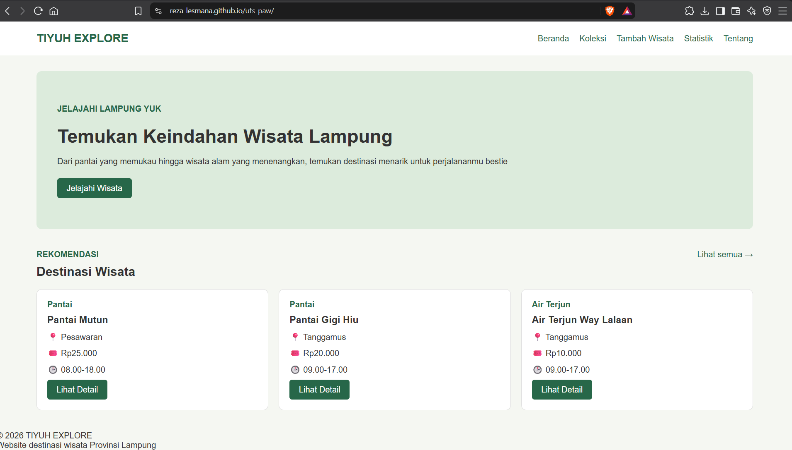

# TIYUH EXPLORE

## Identitas Mahasiswa

Nama: Reza Lesmana Julgi

NIM: 124140115

Kelas: RA

Tema: Destinasi Wisata Lampung

## URL Deployment

https://reza-lesmana.github.io/uts-paw/

## Deskripsi Aplikasi

TIYUH EXPLORE merupakan aplikasi web untuk menjelajahi berbagai destinasi wisata yang ada di Provinsi Lampung. Aplikasi ini dibuat menggunakan React sebagai pemenuhan tugas Ujian Tengah Semester Pengembangan Aplikasi Web.

## Fitur Aplikasi

1. Beranda untuk menampilkan rekomendasi wisata.
2. Koleksi wisata untuk melihat daftar destinasi.
3. Pencarian wisata berdasarkan judul.
4. Detail informasi setiap destinasi wisata.
5. Menambahkan destinasi wisata baru.
6. Menghapus destinasi wisata dengan konfirmasi.
7. Statistik jumlah wisata berdasarkan kategori.
8. Halaman tentang yang menampilkan identitas mahasiswa.
9. Penyimpanan data menggunakan localStorage.
10. Halaman 404 untuk rute yang tidak ditemukan.

## Teknologi yang Digunakan

- React
- JavaScript
- React Router
- HTML
- CSS
- Vite
- Vitest
- Testing Library

## Cara Menjalankan Aplikasi

1. Clone repository:

   `git clone https://github.com/Reza-Lesmana/uts-paw.git`

2. Masuk ke folder aplikasi:

   `cd uts-paw/app`

3. Install dependencies:

   `npm install`

4. Jalankan aplikasi:

   `npm run dev`

5. Buka alamat lokal yang ditampilkan di terminal.

## Tangkapan Layar Aplikasi

### Beranda

### Koleksi Wisata

### Detail Wisata

### Tambah Wisata

### Statistik

### Tentang

